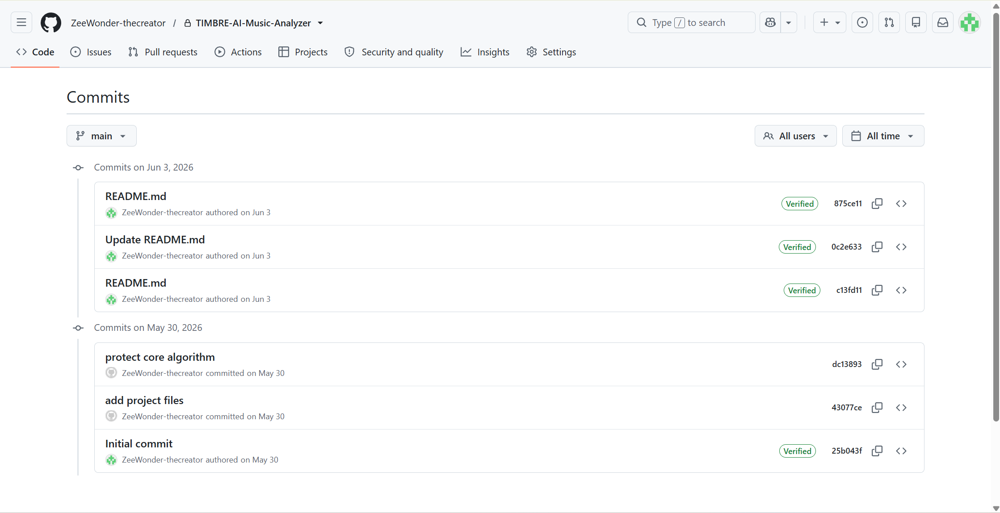

# RESON / TIMBRE 早期版本展示

> 整理自 2026 年 5 月 30 日提交的 TIMBRE 早期版本。展示资料整理于 **2026 年 10 月 29 日**，新展示仓库的创建和上传日期以 GitHub 实际记录为准。

RESON 最初叫 TIMBRE。它源于一个听歌时的疑问：那些吸引我的声音是什么，又是怎样做出来的？

这个仓库公开早期界面模板、产品初衷和开发记录，记录项目从 TIMBRE 到 RESON 的过程。它不是目前线上产品的完整源代码，也不包含后端测量算法、模型调用逻辑、密钥或用户数据。

当前网站：[reson.media](https://reson.media)

## 可以在这里看到什么

- [早期产品初衷](docs/early-product-excerpt.md)：摘自当时的产品需求文档。
- [早期首页模板](early-templates/index.html)
- [早期分析进度页模板](early-templates/loading.html)
- [早期分析结果页模板](early-templates/result.html)
- [早期术语页模板](early-templates/glossary.html)
- [原始提交记录整理](records/original-commits.csv)：保留原提交编号、作者时间、提交者时间和提交说明，未附带代码历史。
- [文件来源与校验信息](records/source-files.json)：记录每份公开模板所对应的原始文件、提交编号和 SHA-256 校验值。

这些 HTML 是历史服务端模板，保留了当时的模板语法与交互代码，供查看源码。未提供后端，不是可以直接完成歌曲分析的独立程序，也不代表目前网站的效果或能力。

## 开发记录

以下时间为原仓库提交中记录的北京时间（UTC+8）：

| 时间 | 记录 |
| --- | --- |
| 2026-05-30 15:05 | 创建初始 README |
| 2026-05-30 15:30 | 提交早期程序、界面和产品文档 |
| 2026-05-30 15:35 | 调整公开代码范围，移除部分实现 |
| 2026-06-03 14:20–14:21 | 调整 README |
| 2026-10-29 | 整理本展示资料 |

原始开发仓库目前保持私有，用于保留完整开发记录。本仓库没有导入原仓库的 Git 历史；上面的历史日期是来源记录，不是对本展示仓库上传日期的倒签。

### 原仓库提交记录截图

以下为原私有仓库的 GitHub 提交历史页面截图，截取于2026年10月29日，展示2026年5月30日及6月3日的早期开发记录。

## 关于公开范围

仅展示项目的早期面貌。历史文档中的目标与判断应结合其时间理解，不作为当前功能承诺。未公开的后端实现及当前版本代码不在本展示范围内。
